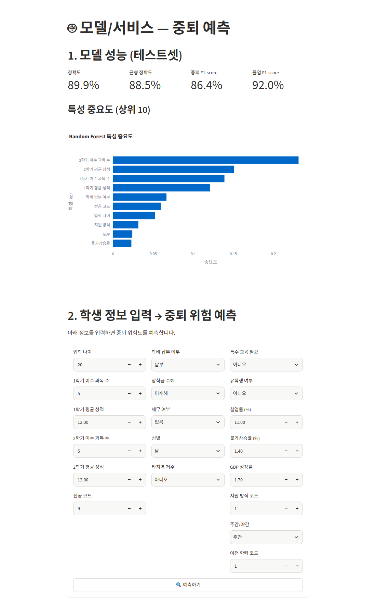
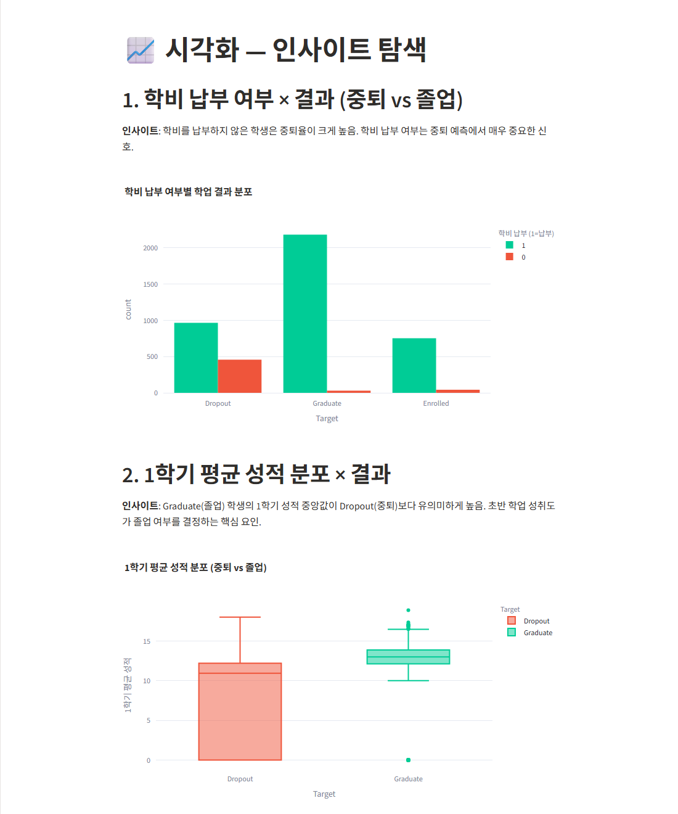
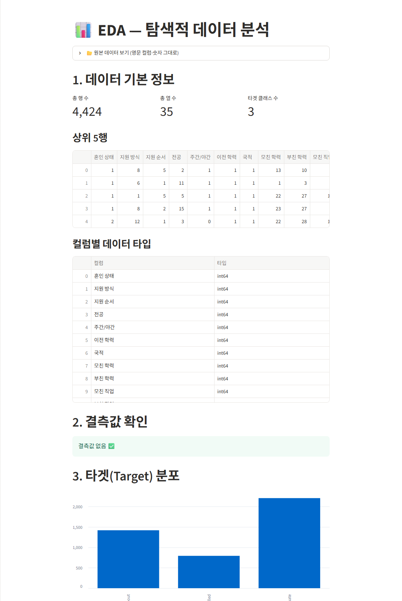

# 🎓 학생 중퇴 위험 예측 AI 웹 서비스

학생의 입학 정보·성적·재정 상태를 입력하면 **중퇴 위험을 예측하고 주요 위험 요인을 알려 주는** Streamlit 웹 서비스입니다.
대학이 위험 학생을 조기에 찾아 지원할 수 있도록 돕는 것을 목표로 했습니다.


> 동양미래대학교 인공지능소프트웨어학과 · 빅데이터분석프로젝트 기말 프로젝트 (2026.03 ~ 2026.06, 개인)
> 코드는 [`final_project/`](final_project) 폴더에 있습니다.

---

## 한눈에 보기

| 항목 | 내용 |
|---|---|
| **문제** | 학생이 중퇴할지, 졸업할지 예측 |
| **데이터** | Kaggle *Higher Education Predictors of Student Retention* (포르투갈 고등교육, 4,424명 × 35개 열, CC BY 4.0) |
| **핵심 결정** | 결과가 정해지지 않은 '재학중' 학생을 빼고 **중퇴 vs 졸업 이진 분류로 재정의** (3,630명) |
| **모델** | Random Forest (트리 100개, 80/20 층화 분할), 설명하기 쉬운 변수 19개 사용 |
| **성능** | **정확도 89.9% · 균형 정확도 88.5%** · 중퇴 F1 86.4% · 졸업 F1 92.0% |
| **서비스** | Streamlit 멀티페이지: EDA → 시각화 → 입력하면 중퇴 확률 예측 |



---

## 1. 문제 재정의

원래 데이터의 결과(Target)는 **중퇴 / 졸업 / 재학중** 3가지입니다.
그런데 '재학중'은 아직 결과가 정해지지 않은 학생이라, 그대로 학습하면 정답이 흐려지는 노이즈가 됩니다.
그래서 재학중 학생을 빼고 **중퇴 vs 졸업** 두 가지로 문제를 다시 정의했습니다.

| 구분 | 학생 수 | 사용 여부 |
|---|---:|---|
| 졸업 (Graduate) | 2,209명 | ✅ 학습 |
| 중퇴 (Dropout) | 1,421명 | ✅ 학습 |
| 재학중 (Enrolled) | 794명 | ❌ 제외 |
| **학습 데이터** | **3,630명** | |

## 2. 데이터에서 찾은 것

| 발견 | 중퇴 학생 | 졸업 학생 |
|---|---:|---:|
| 1학기 평균 성적 | 7.3점 | 12.6점 |
| 학비 미납 비율 | 32.2% | 1.3% |

- **입학 첫 학기 성적**만으로도 중퇴 위험을 일찍 알아챌 수 있습니다.
- **학비 미납** 비율이 졸업생의 약 25배로, 재정 지원이 중퇴 예방의 열쇠입니다.



## 3. 모델

- **알고리즘**: `RandomForestClassifier(n_estimators=100, random_state=42)`
  - 변수 사이의 비선형 관계와 상호작용을 잘 잡고, 변수 중요도로 결과를 설명할 수 있어 선택했습니다.
- **분할**: 학습 80% / 테스트 20%, 클래스 비율을 유지하는 층화 분할
- **변수**: 35개 열 중 서비스에서 입력받기 쉽고 해석 가능한 **19개**를 골랐습니다. 대부분 0인 열, 다른 변수와 겹치는 열, 입력 부담이 큰 열은 뺐습니다.
- **평가 지표**: 중퇴 1,421명 vs 졸업 2,209명으로 불균형하기 때문에, 정확도만 보면 많은 쪽(졸업)에 치우친 모델도 좋아 보일 수 있습니다. 그래서 **균형 정확도와 클래스별 F1**을 함께 봤습니다.

| 지표 | 값 |
|---|---:|
| 정확도 | **89.9%** |
| 균형 정확도 | **88.5%** |
| 중퇴 F1 | 86.4% |
| 졸업 F1 | 92.0% |

**중퇴 예측에 영향이 큰 변수 TOP 5**

| 순위 | 변수 | 중요도 |
|---:|---|---:|
| 1 | 2학기 이수 과목 수 | 23.1% |
| 2 | 2학기 평균 성적 | 15.1% |
| 3 | 1학기 이수 과목 수 | 13.9% |
| 4 | 1학기 평균 성적 | 12.1% |
| 5 | 학비 납부 여부 | 6.7% |

상위 4개가 전체 중요도의 약 62%로, EDA에서 본 패턴과 같습니다.

## 4. 앱 화면

| 페이지 | 내용 |
|---|---|
| 🏠 홈 (`app.py`) | 서비스 소개와 페이지 안내 |
| 📊 EDA (`pages/1_EDA.py`) | 기본 정보, 결측값 확인, 결과 분포, 컬럼별 분포 |
| 📈 시각화 (`pages/2_시각화.py`) | 학비 납부·성적·나이·장학금과 중퇴의 관계 그래프 + 해석 |
| 🤖 모델 서비스 (`pages/3_모델_서비스.py`) | 모델 성능, 변수 중요도, **학생 정보 입력 → 중퇴 확률과 위험 요인** |

<details>
<summary>EDA 화면 보기</summary>



</details>

## 5. 실행 방법

```bash
cd final_project
pip install -r requirements.txt   # Python 3.10 이상 권장
streamlit run app.py
```

## 6. 폴더 구조

```
final_project/
├── app.py                  # 홈
├── pages/
│   ├── 1_EDA.py            # 탐색적 데이터 분석
│   ├── 2_시각화.py          # 인사이트 그래프
│   └── 3_모델_서비스.py      # 학습·평가·예측
├── src/
│   ├── data_loader.py      # 데이터 불러오기 (캐시)
│   └── features.py         # 사용할 변수 19개, 이진 분류용 X·y 준비
├── data/dataset.csv        # 원본 데이터
├── 문제정의.md
└── 보고서.md               # 상세 분석 보고서
```

## 7. 한계와 다음 단계

| 한계 | 다음 단계 |
|---|---|
| 포르투갈 데이터라 국내 대학에 바로 적용하기 어려움 | 국내 데이터로 다시 학습 |
| 재학중 학생의 미래 중퇴는 예측하지 못함 | 3클래스 모델이나 학기별 시계열 접근 |
| Random Forest 하나만 사용 | XGBoost, 로지스틱 회귀와 비교 |
| 예측 근거가 전체 변수 중요도 수준 | SHAP으로 학생별 예측 근거 제공 |

---

## 수업 실습 기록

이 저장소에는 같은 과목의 주차별 실습도 함께 들어 있습니다.

| 폴더 | 내용 |
|---|---|
| `4week/` | Streamlit 기초, 멀티페이지 앱, EDA 대시보드 |
| `5week/` | 영화 리뷰(NSMC) 감성 분석 대시보드 |
| `6week/` | Ollama 로컬 LLM 기초 (대화, 스트리밍, temperature) |
| `7week/` | LLM 프롬프트 엔지니어링, JSON 출력, 감성 분석 챗봇 |
| `10week/` | CSIC 2010 HTTP 요청 데이터로 웹 공격 탐지 (EDA, 전처리, LLM 분류와 프롬프트 비교) |
| `11week/` | 이미지 처리 기초, 데이터 증강, 사전학습 ViT, YOLO 객체 탐지 |

---

**이종복** · 동양미래대학교 인공지능소프트웨어학과 · [GitHub](https://github.com/JONGBOK1)
